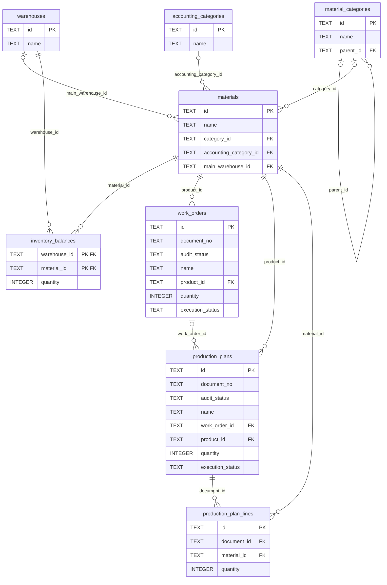
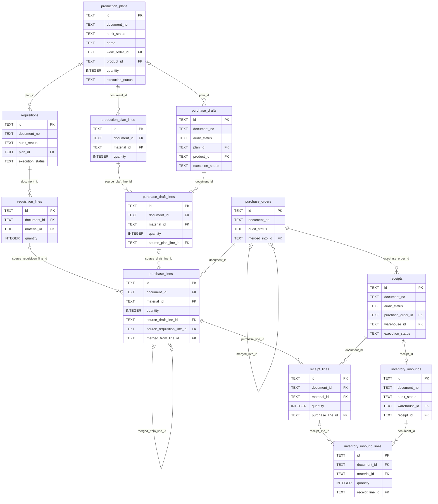
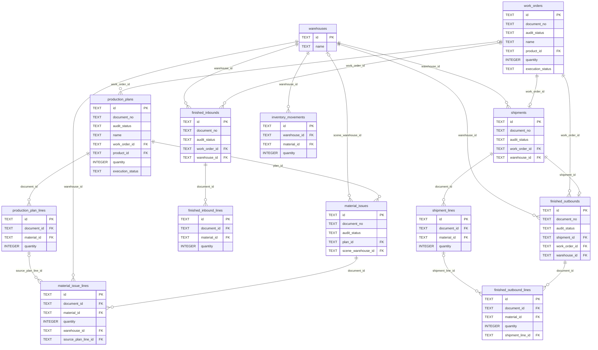
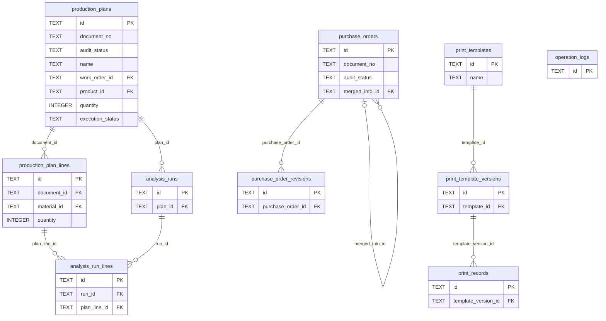

# WSN 数据库 ER 图

基于 [数据库设计](README.md) 与 [可执行表结构](schema.sql)。完整关系源文件为 [er.mmd](er.mmd)；下图拆成四部分便于阅读。

图中的关系仅表示真实 SQL 外键。库存流水的来源三元组以及打印、日志的跨类型引用由应用在事务内校验，不绘制成并不存在的外键。文档未指定供应商主档，本期供应商和客户采用文本快照。

## 主档、库存与生产

## 需求、采购与收货

## 领料、成品入库与发货

## 分析、版本、打印与日志（预留）

